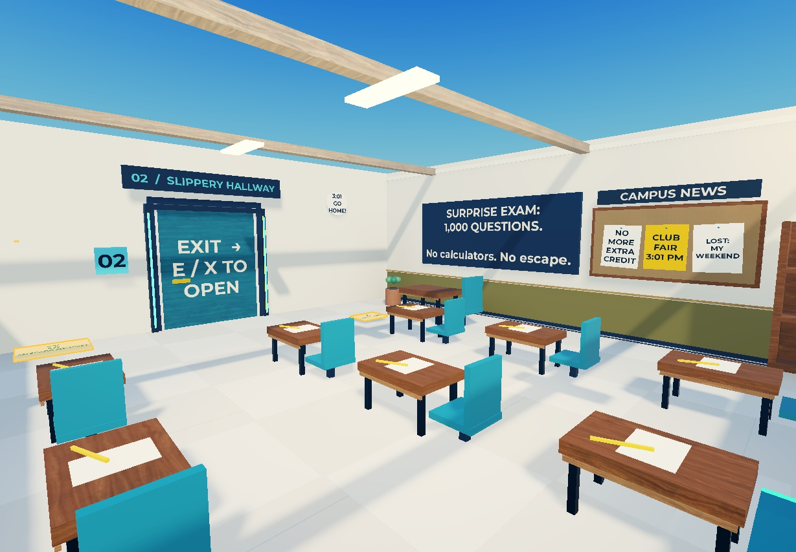

# ESCAPE THE PROFESSOR!

A playable Roblox school escape game built with Luau and Rojo. Collect homework, dodge obstacles, answer a quiz, steal the exit key, and outrun Professor Popquiz to the school bus.

**Deployed application:** [Play ESCAPE THE PROFESSOR! on Roblox](https://www.roblox.com/games/129658265022575/)

**GitHub repository:** [tobyongo34/escape-the-professor](https://github.com/tobyongo34/escape-the-professor)



## Team

| Group member | Assigned project role | Responsibility |
| --- | --- | --- |
| Peace Funso-Ore | Game design | Explain and maintain the game rules, room order, and checkpoint progression. |
| James Hunter | Programming | Explain and maintain Luau scripts, interactions, and quiz logic. |
| Emaury Onyeneho | Visuals and interface | Explain and maintain the school design, professor appearance, and player interface. |
| Tobenna Uyanwune | Testing and improvements | Review bugs, evaluate chase difficulty, and lead the game demonstration. |

These are assigned project and presentation responsibilities. The project used AI assistance for implementation and debugging, as described below. The roles do not assert that a particular student originally wrote every file in that area.

## Gameplay

| Room | Player objective |
| --- | --- |
| 1. Surprise Exam | Find three glowing homework sheets and open the classroom exit. |
| 2. Slippery Hallway | Dodge moving pencils and reach the hallway checkpoint. |
| 3. The Floor Is Homework | Jump across giant books and use the library checkpoints. |
| 4. Pop Quiz Door | Answer three randomized questions to unlock the exit. |
| 5. Steal the Exit Key | Collect the gold key while avoiding the professor. |
| 6. Final Bell | Weave around exam carts, jump hurdles, and sprint to the bus. |

Additional features include six optional hall passes, checkpoint retries, sprint stamina, a timer, end-of-run grades, replay controls, and a session-best time. Settings provide objective hints, sound effects, and reduced motion. Session records reset when the player leaves the server.

## Technologies and AI tools

| Technology or tool | How this project uses it |
| --- | --- |
| Roblox Studio and the Roblox engine | Scene editing, physics, UI, local playtesting, and publishing the experience. |
| Luau | All production gameplay scripts and modules. |
| Rojo 7.7.0 | Sync local `src/` files into their mapped Studio objects. |
| Git and GitHub | Version control, source hosting, documentation, and class submission. |
| OpenAI Codex / ChatGPT | AI assistance with implementation, debugging, documentation, and presentation preparation. |
| Roblox Studio MCP tools | Let the AI assistant inspect Studio, execute development commands, build scene content outside Rojo-managed folders, and run playtests. MCP is a development connection, not the professor's runtime AI. |

The professor uses scripted state logic and Roblox pathfinding. The running game does **not** call an AI model or require an OpenAI key, MCP connection, or paid AI service. See [AI usage and development responsibilities](docs/AI_USAGE.md).

## Installation and setup

### Requirements

- A Roblox account and [Roblox Studio](https://create.roblox.com/docs/studio/setup) on Windows or macOS for local play or editing.
- [Git](https://git-scm.com/downloads/) to clone the repository. Alternatively, choose **Code > Download ZIP** on GitHub and extract it.
- **For source editing:** the [Rojo 7.7.0 CLI](https://github.com/rojo-rbx/rojo/releases/tag/v7.7.0) and matching Rojo 7 Studio plugin. Rojo is not needed just to play the included complete save.

### 1. Download the project

```sh
git clone https://github.com/tobyongo34/escape-the-professor.git
cd escape-the-professor
```

There are no npm packages, database migrations, or environment variables to configure for the game.

### 2. Open the complete game

1. Start Roblox Studio and sign in.
2. Choose **File > Open from File** and select [`ESCAPE THE PROFESSOR - Campus Upgrade.rbxl`](<ESCAPE THE PROFESSOR - Campus Upgrade.rbxl>).
3. Keep this complete save open while editing or testing.

The `.rbxl` includes the school, professor model, and scripts. **A Rojo build alone contains the scripts, not the complete school.** Do not use an empty baseplate or a scripts-only export as the playable application.

### 3. Install Rojo for development

Follow the [official Rojo installation instructions](https://rojo.space/docs/v7/getting-started/installation/). Download and extract the CLI for your operating system, then add the executable's folder to `PATH` and reopen the terminal. The project was tested with version 7.7.0.

```sh
rojo --version
rojo plugin install
```

Restart Studio if the plugin does not appear. If you already use Rokit, this repository's `rokit.toml` pins Rojo 7.7.0, so `rokit install` is an alternative to manually installing the CLI.

### 4. Connect local source files to Studio

From the repository root:

```sh
rojo serve default.project.json
```

In Studio, open the **Rojo** plugin and connect to **localhost:34872**. Review and accept the initial sync for this project. Keep the terminal running while editing files in `src/`.

## Running the application

### Play the deployed game

Open [the Roblox game page](https://www.roblox.com/games/129658265022575/) and press **Play**. Roblox may prompt you to install or launch Roblox Player.

The latest recorded publication is Campus Upgrade, place version 4. On October 4, 2026, Creator Dashboard showed Public access with audience reach **Ages 16+ and trusted friends**. Roblox account eligibility can affect joining. The local Studio test is the alternative for a classroom demonstration.

### Run locally

1. Open the complete `.rbxl` save as described above.
2. In Studio, select **Play** from the Test controls, or press **F5** on Windows.
3. Click **LET'S GET OUT OF HERE** in the menu.
4. Complete the objectives shown on the HUD. Use Studio's **Stop** control to end the test.

| Action | Keyboard | Touch | Controller binding |
| --- | --- | --- | --- |
| Move | WASD | Movement stick | Left stick |
| Jump | Space | Jump button | A |
| Interact | E | Tap the prompt | X |
| Sprint | Shift | RUN toggle | L3 |

Controller bindings exist in the source. Physical controller testing is still pending, and console access was not enabled in the recorded publication.

## Project structure

```text
escape-the-professor/
├── README.md
├── default.project.json             # Rojo mapping and port
├── rokit.toml                       # Optional pinned Rojo toolchain
├── ESCAPE THE PROFESSOR - Campus Upgrade.rbxl
├── src/
│   ├── server/                      # Authoritative gameplay, 5 files
│   │   ├── Main.server.luau
│   │   ├── Progression.luau
│   │   ├── Interactions.luau
│   │   ├── ProfessorAI.luau
│   │   └── Quiz.luau
│   ├── client/                      # Input, interface, effects, 4 files
│   │   ├── Main.client.luau
│   │   ├── UI.luau
│   │   ├── Effects.luau
│   │   └── Guidance.luau
│   └── shared/                      # Shared settings and coordinates
│       ├── Config.luau
│       └── Course.luau
├── studio/                          # 6 edit-time map/visual recipes
├── tests/                           # Studio regression driver and guide
├── docs/                            # Architecture, AI usage, screenshots
├── presentation/output/             # Class PowerPoint and rehearsal guide
└── *_STATUS.md / *_UPGRADE.md        # Development and verification records
```

All 11 production source files, the map-building recipes, and the regression driver are included. The complete save preserves scene content that Rojo does not manage. Local downloaded executables, credentials, temporary presentation files, redundant ZIP archives, and older save backups are excluded by `.gitignore`.

## Rojo ownership and architecture

| Local folder | Managed Studio objects |
| --- | --- |
| `src/shared/` | `ReplicatedStorage.EscapeShared` |
| `src/server/` | `ServerScriptService.EscapeServer` |
| `src/client/` | `StarterPlayer.StarterPlayerScripts.EscapeClient` |

Edit these scripts locally and let Rojo synchronize them. Direct Studio edits inside these mapped folders can be overwritten by the next sync.

`Workspace.EscapeSchool`, `ServerStorage.EscapeAssets`, and Lighting are outside this mapping. Runtime scripts create the interface, remotes, and professor instances. Save the complete place after scene changes so the `.rbxl` stays up to date. The files in `studio/` are development recipes and should not be installed as live game scripts or rerun over manual map edits.

The server owns stage progression, quiz answers, stamina, catches, and replay state. Clients send input and display server results. The quiz answer bank stays in `ServerScriptService`, not `ReplicatedStorage`. See [architecture and source guide](docs/ARCHITECTURE.md).

## Testing

Start with a normal Studio playtest: start the menu, move and jump, collect homework, verify an exit rejects incomplete objectives, reach checkpoints, and test replay.

The [regression guide](tests/README.md) explains how to temporarily install and invoke the Studio-only test driver. Remove the temporary driver before saving or publishing a normal game.

Recorded October 4 checks include 100 seeded quiz decks, six progression checks, eleven collectible/replay checks, moving hallway and staff-room patrols, and controlled walking/sprinting attempts in the finale. Desktop and phone simulator layouts were inspected. These checks do not replace physical phone/controller testing or newcomer difficulty studies. See [Campus Upgrade results](CAMPUS_UPGRADE.md) for exact measurements and limitations.

## Troubleshooting

- **Rojo cannot connect:** keep `rojo serve default.project.json` running and use `localhost:34872` in the Studio plugin. This project does not use Rojo's usual default port.
- **`rojo` is not recognized:** add the extracted executable's folder to `PATH`, then reopen the terminal, or run the executable by its full path.
- **The map is missing:** open the complete Campus Upgrade `.rbxl`, not a scripts-only build.
- **Studio stays on Loading Studio:** try **File > Open from File** (`Ctrl+O` on Windows) to open the saved place directly. This bypassed a start-page problem during development, but it is not a general repair for Studio.
- **The online game will not let someone join:** check the Roblox account's eligibility and the experience's audience setting. Use a local Studio test for the demo if needed.

## Class presentation

- [PowerPoint presentation](<presentation/output/ESCAPE THE PROFESSOR - Class Presentation.pptx>) with screenshots, code examples, assigned roles, and speaker notes.
- [Rehearsal guide](<presentation/output/Rehearsal Guide.md>) for the four presenters.
- [Publication record](PUBLISH_STATUS.md) and [development workflow](WORKFLOW.md).

For the class submission, share this repository URL and the deployed Roblox link at the top of this README.
